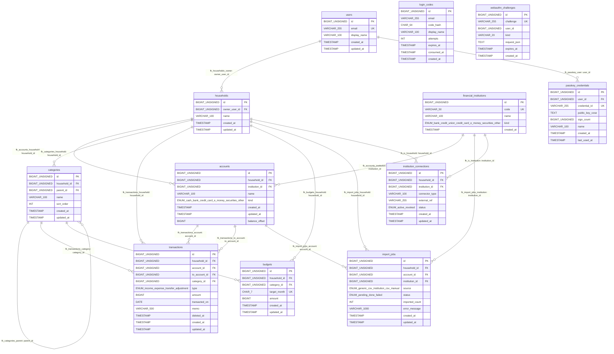

# ER図

生成元: `db/migration/V*.sql`（全マイグレーション適用後）の外部キー制約。

## リレーション一覧

| 制約名 | 参照元 | 参照先 |
|---|---|---|
| fk_households_owner | households.owner_user_id | users.id |
| fk_accounts_household | accounts.household_id | households.id |
| fk_accounts_institution | accounts.institution_id | financial_institutions.id |
| fk_categories_household | categories.household_id | households.id |
| fk_categories_parent | categories.parent_id | categories.id |
| fk_transactions_household | transactions.household_id | households.id |
| fk_transactions_account | transactions.account_id | accounts.id |
| fk_transactions_to_account | transactions.to_account_id | accounts.id |
| fk_transactions_category | transactions.category_id | categories.id |
| fk_budgets_household | budgets.household_id | households.id |
| fk_budgets_category | budgets.category_id | categories.id |
| fk_import_jobs_household | import_jobs.household_id | households.id |
| fk_import_jobs_account | import_jobs.account_id | accounts.id |
| fk_import_jobs_institution | import_jobs.institution_id | financial_institutions.id |
| fk_ic_household | institution_connections.household_id | households.id |
| fk_ic_institution | institution_connections.institution_id | financial_institutions.id |
| fk_passkey_user | passkey_credentials.user_id | users.id |
