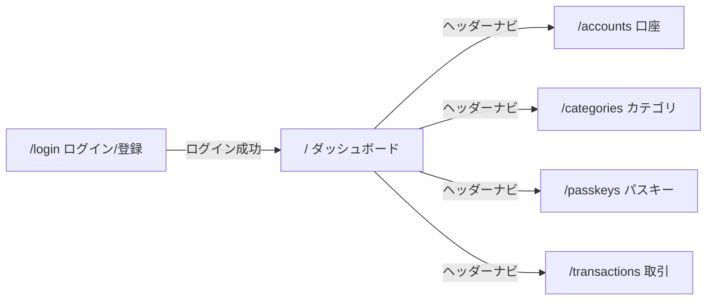

# 画面定義書

生成元: `apps/web/app/pages/*.vue`。共通レイアウト（ヘッダーナビ）は `apps/web/app/layouts/default.vue`。未ログイン時はログイン画面へ誘導する。

## 画面一覧

| ルート | 画面名 | 画面ファイル | 主なセクション | 利用API |
|---|---|---|---|---|
| `/accounts` | 口座 | `apps/web/app/pages/accounts.vue` | - | `/api/accounts`, `/api/institutions`, `/api/accounts/{param}` |
| `/categories` | カテゴリ | `apps/web/app/pages/categories.vue` | - | `/api/categories`, `/api/categories/{param}` |
| `/` | ダッシュボード | `apps/web/app/pages/index.vue` | カテゴリ別支出, 口座残高 | `/api/summary/monthly?month={param}`, `/api/accounts` |
| `/login` | Kakeibo | `apps/web/app/pages/login.vue` | - | `/api/auth/request-code`, `/api/auth/passkey/login/options`, `/api/auth/passkey/login/verify`, `/api/auth/verify-code` |
| `/passkeys` | パスキー | `apps/web/app/pages/passkeys.vue` | - | `/api/passkeys`, `/api/passkeys/register/options`, `/api/passkeys/register/verify`, `/api/passkeys/{param}` |
| `/transactions` | 取引 | `apps/web/app/pages/transactions.vue` | - | `/api/transactions?month={param}`, `/api/accounts`, `/api/categories`, `/api/transactions/{param}`, `/api/transactions`, `/api/transactions/import?accountId={param}`, `/api/transactions/export.csv?month={param}` |

## 画面遷移図

## 画面詳細

### /accounts 口座

- 画面ファイル: `apps/web/app/pages/accounts.vue`
- 入力要素: input type = text / select 2件
- 利用API: `/api/accounts`, `/api/institutions`, `/api/accounts/{param}`

### /categories カテゴリ

- 画面ファイル: `apps/web/app/pages/categories.vue`
- 入力要素: input type = text / select 1件
- 利用API: `/api/categories`, `/api/categories/{param}`

### / ダッシュボード

- 画面ファイル: `apps/web/app/pages/index.vue`
- 入力要素: input type = month
- 利用API: `/api/summary/monthly?month={param}`, `/api/accounts`

### /login Kakeibo

- 画面ファイル: `apps/web/app/pages/login.vue`
- 入力要素: input type = email, text
- 利用API: `/api/auth/request-code`, `/api/auth/passkey/login/options`, `/api/auth/passkey/login/verify`, `/api/auth/verify-code`

### /passkeys パスキー

- 画面ファイル: `apps/web/app/pages/passkeys.vue`
- 入力要素: input type = text
- 利用API: `/api/passkeys`, `/api/passkeys/register/options`, `/api/passkeys/register/verify`, `/api/passkeys/{param}`

### /transactions 取引

- 画面ファイル: `apps/web/app/pages/transactions.vue`
- 入力要素: input type = date, file, month, number, text / select 5件
- 利用API: `/api/transactions?month={param}`, `/api/accounts`, `/api/categories`, `/api/transactions/{param}`, `/api/transactions`, `/api/transactions/import?accountId={param}`, `/api/transactions/export.csv?month={param}`
